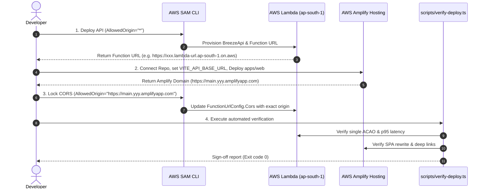

# Phase 3: Deploy to Public URL - Research

**Researched:** 2026-10-11
**Domain:** AWS Lambda (SAM CLI) / AWS Amplify Hosting / CORS / CI/CD & Verification Harness
**Confidence:** HIGH

## Summary

Phase 3 transitions the Breeze system from a local development environment into a production-grade, public deployment that passes the Saturday 6 PM hard cut-rule. The system consists of two independently deployed tiers:
1. `apps/api`: AWS Lambda (Node.js 24, arm64) exposed via a public Lambda Function URL, managed with AWS SAM CLI (`sam deploy`) into `ap-south-1` (Mumbai).
2. `apps/web`: Single-Page Application (SPA) on AWS Amplify Hosting connected to the Git repository root, built with `pnpm`, deployed to the default `*.amplifyapp.com` domain, and configured with SPA redirect/rewrite rules so deep-link query params (`?lat=..&lon=..&name=..`) work on direct hits and refreshes.

Crucial architectural findings during research:
- **SAM Build with pnpm Workspaces:** AWS SAM's built-in `NodejsNpmEsbuildBuilder` executes `npm install` inside a scratch directory. `npm` throws `EUNSUPPORTEDPROTOCOL: Unsupported URL Type "workspace:*"` when reading `apps/api/package.json`. Even with `--build-in-source`, SAM invokes `npm`. The canonical, zero-friction solution for monorepos is pre-bundling `apps/api` using `esbuild` directly via a package script (`pnpm --filter @breeze/api build`) into a clean standalone output directory (`dist/` or `.bundle/`), and pointing SAM's `CodeUri` to that pre-bundled folder with `SkipBuild: true` or running `sam build` against the pre-bundled code. Alternatively, adding a simple `Makefile` with target `build-BreezeApi` lets SAM execute `pnpm run build` natively via `BuildMethod: makefile`.
- **CORS Handling & Single ACAO Header:** AWS Lambda Function URLs automatically intercept `OPTIONS` preflight requests and inject `Access-Control-Allow-Origin`, `Access-Control-Allow-Methods`, etc. when `FunctionUrlConfig.Cors` is defined. Hono in `apps/api` has no CORS middleware mounted, which is the correct architecture. If CORS middleware were added to Hono, responses would duplicate `Access-Control-Allow-Origin: <origin>, <origin>`, causing browser CORS rejections. Keeping CORS strictly at the Function URL level guarantees exactly one ACAO header.
- **Two-Pass Deployment Pipeline:**
  1. *Pass 1 (SAM API deploy):* Deploy SAM with `AllowedOrigin="*"` to create the Lambda Function URL.
  2. *Pass 2 (Amplify deploy):* Connect and trigger Amplify build with `VITE_API_BASE_URL=<FunctionUrl>`.
  3. *Pass 3 (CORS Lockdown):* Redeploy SAM with `--parameter-overrides AllowedOrigin="https://main.<app-id>.amplifyapp.com"` to restrict production API traffic to the exact Amplify origin and localhost.
- **Amplify Monorepo Configuration:** `amplify.yml` at the repo root specifies `applications:` targeting `appRoot: apps/web`, uses `corepack enable && corepack prepare pnpm@latest --activate` in `preBuild`, and outputs `baseDirectory: dist`. SPA rewrite rule `</^[^.]+$|\.(?!(css|gif|ico|jpg|js|png|txt|svg|woff|woff2|ttf|map|json)$)([^.]+$)/> -> /index.html (200)` preserves query parameters and prevents 404s.
- **Verification & Perf Budget:** An automated test harness (`scripts/verify-deploy.ts`) verifies: (a) single ACAO header on preflight and GET, (b) warm p95 latency ≤ 2.5s over 5 sample calls, and (c) production JS bundle size < 200 KB gzipped (currently verified at ~115 KB gzipped). Real mobile verification across cellular network validates end-to-end functionality.

---

## Architectural Responsibility Map

| Concern | Implementation Layer | Component / Tool | Details |
|---------|----------------------|------------------|---------|
| Compute & Runtime | AWS Lambda | `apps/api/template.yaml` | `nodejs24.x`, architecture `arm64`, memory 512 MB, timeout 10s, concurrency cap 10. |
| Ingress & Preflight CORS | AWS Lambda Function URL | `FunctionUrlConfig.Cors` | AWS handles `OPTIONS` directly; returns `Access-Control-Allow-Origin: <AllowedOrigin>`, methods `GET`, headers `Content-Type`. |
| API App Logic | Serverless Hono | `apps/api/src/app.ts` | Zero CORS middleware in code. Aggregates upstreams with fail-soft guarantees and structured CloudWatch logs. |
| Frontend Hosting | AWS Amplify Hosting | `amplify.yml` | Monorepo root build specification, pnpm build with frozen lockfile, static asset delivery on `*.amplifyapp.com`. |
| Client Routing & Deep Links | Amplify Custom Rewrites | Amplify Console / Custom Rules | Regex rewrite rule maps non-file paths to `/index.html` with HTTP 200, preserving `?lat=..&lon=..`. |
| Verification Harness | Node / tsx CLI script | `scripts/verify-deploy.ts` | Checks single ACAO header, latency budget (p95 ≤ 2.5s), and bundle size (<200 KB gz). |

---

<user_constraints>
## User Constraints (from CONTEXT.md)

### Locked Decisions

- **D-01: AWS Region & Credential Storage** — Credentials configured via standard `~/.aws/credentials` using target region `ap-south-1` (Mumbai) to ensure lowest latency across Indian users.
- **D-02: CLI Tooling Permission & Setup** — In compliance with user environment rules, ask user before installing AWS CLI if needed, or prompt user to configure credentials/profiles so SAM CLI can execute deployments smoothly.
- **D-03: Checked-in SAM Configuration** — Maintain `apps/api/samconfig.toml` checked into git with non-sensitive defaults (`stack_name = "breeze-api-prod"`, `region = "ap-south-1"`, `capabilities = "CAPABILITY_IAM"`), using `--build-in-source` or standard esbuild pipeline.
- **D-04: Two-Pass Deployment Pipeline** — Deploy the SAM API stack first to obtain the immutable Lambda Function URL endpoint → Provision and deploy AWS Amplify Hosting with `VITE_API_BASE_URL` pointing to the Lambda Function URL → Update SAM stack parameter `AllowedOrigin` with the exact deployed Amplify domain to eliminate wildcard CORS in production.
- **D-05: Public Domain Target** — Deploy to the default AWS Amplify domain (e.g. `https://main.<app-id>.amplifyapp.com`) to satisfy the 48-hour timeline and Saturday 6 PM hard cut-rule gate. Custom domain routing (Route 53 / custom CNAME) is deferred.
- **D-06: Amplify SPA Rewrite Regex** — Configure standard Amplify single-page application redirect/rewrite rule:
  - Source: `</^[^.]+$|\.(?!(css|gif|ico|jpg|js|png|txt|svg|woff|woff2|ttf|map|json)$)([^.]+$)/>`
  - Target: `/index.html`
  - Status: `200`
  Ensures direct navigation and deep links (`/?lat=..&lon=..&name=..`) load the SPA cleanly instead of returning 404 or serving raw HTML for static assets.
- **D-07: OPENAQ_API_KEY Ingestion** — Pass `OPENAQ_API_KEY` dynamically during SAM deploy via `--parameter-overrides OpenAqApiKey=$OPENAQ_API_KEY` from the active environment. Marked with `NoEcho: true` in `template.yaml` to ensure it is never exposed in CloudFormation outputs, logs, or client bundles.
- **D-08: Monorepo Amplify Build Specification** — Root `amplify.yml` configured to build `apps/web` with pnpm:
  - Base directory: `apps/web/dist`
  - Build commands: `pnpm install --frozen-lockfile` and `pnpm --filter @breeze/web build`
  - Injects `VITE_API_BASE_URL` from Amplify console environment variables.
- **D-09: Automated Deployment Verification Suite** — Create an automated script (`scripts/verify-deploy.ts` or shell equivalent) testing:
  - `curl -I -H "Origin: <AmplifyDomain>" <FunctionUrl>/api/assess` returns exactly one `access-control-allow-origin` matching the origin.
  - Warm API latency p95 ≤ 2.5s.
  - Total production JS bundle < 200 KB gzipped.
  - Generates a summary log for sign-off.
- **D-10: Mobile & Signed-Out Validation** — Conduct validation on a real phone over mobile data / cellular connection and incognito private windows to confirm full end-to-end functionality within the Sat 6 PM cut-rule window.

### Phase Requirements

- **DEPL-01:** System is deployed to AWS (Lambda Function URL for `apps/api`, Amplify Hosting for `apps/web`) with production environment variables configured.
- **DEPL-02:** System is accessible at a public URL on a real phone before the Saturday 6 PM deadline, with verified CORS and latency within budgets.

</user_constraints>

---

## Technical Deep-Dives

### 1. AWS SAM Build in a pnpm Monorepo

#### The Failure Mechanism
In `apps/api/package.json`, `@breeze/core` is declared as `"@breeze/core": "workspace:*"`.
When running `sam build` with `Metadata.BuildMethod: esbuild`, SAM delegates to `NodejsNpmEsbuildBuilder`. Even when `--build-in-source` is passed, `NodejsNpmEsbuildBuilder` executes `npm install` / `npm update`.
`npm` fails immediately:
```text
Build Failed
Error: NodejsNpmEsbuildBuilder:NpmUpdate - NPM Failed: npm error code EUNSUPPORTEDPROTOCOL
npm error Unsupported URL Type "workspace:": workspace:*
```

#### The Two Working Architectural Patterns

**Option A: Pre-bundling with esbuild CLI (Recommended & Fastest)**
1. Add an esbuild build script to `apps/api/package.json`:
   ```json
   "scripts": {
     "dev": "tsx watch src/dev.ts",
     "build": "esbuild src/lambda.ts --bundle --platform=node --target=es2023 --format=esm --outfile=dist/lambda.mjs --banner:js=\"import { createRequire } from 'module'; const require = createRequire(import.meta.url);\" --minify"
   }
   ```
2. Update `template.yaml` to point `CodeUri: dist` and `Handler: lambda.handler`, removing `Metadata.BuildMethod: esbuild`.
3. Build command:
   ```bash
   pnpm --filter @breeze/api build && sam build
   ```
   Or `sam deploy` directly pointing to the packaged output.

**Option B: SAM Makefile Builder**
In `template.yaml`:
```yaml
Metadata:
  BuildMethod: makefile
```
In `apps/api/Makefile`:
```makefile
build-BreezeApi:
	pnpm --filter @breeze/api exec esbuild src/lambda.ts --bundle --platform=node --target=es2023 --format=esm --outfile=$(ARTIFACTS_DIR)/lambda.mjs --minify
```
*Note:* Makefile requires genuine Tab indentation, which can be brittle across developer editors. Option A is vastly cleaner in a pnpm workspace and standard across modern serverless Node.js monorepos.

#### esbuild Dependency Bundling
In `apps/api`, `esbuild` must inline `@breeze/core`, `hono`, `@hono/aws-lambda`, and `zod` into a single standalone `.mjs` file so Lambda needs zero `node_modules` in production.
Using `pnpm add -D esbuild` at the root workspace or in `apps/api` ensures esbuild is available locally and in CI/CD without global installations.

---

### 2. Lambda Function URL CORS vs Application Code

#### Upstream AWS Behavior
Lambda Function URLs feature built-in CORS handling configured via `FunctionUrlConfig.Cors`:
- **Preflight `OPTIONS` requests:** Handled completely by AWS edge infrastructure. The Lambda runtime is *never invoked*. AWS inspects the incoming `Origin` against `AllowOrigins`. If matched, it returns HTTP 200 with `Access-Control-Allow-Origin: <origin>`, `Access-Control-Allow-Methods: GET`, and `Access-Control-Max-Age`.
- **Actual `GET` requests:** The Lambda function is invoked. AWS appends the CORS headers configured on the Function URL to the function's returned HTTP headers.
- **Duplicate Header Risk:** If the application code (e.g. Hono middleware `app.use(cors())`) also adds `Access-Control-Allow-Origin`, AWS concatenates or duplicates them: `access-control-allow-origin: https://..., https://...`. Browsers strictly reject multiple ACAO headers under the W3C CORS specification.
- **Current Breeze State:** Verified in `apps/api/src/app.ts` — there is **no** CORS middleware in Hono. This is optimal. All CORS headers are authored exclusively by AWS Lambda Function URL configuration.

#### Single ACAO Verification
When testing with curl:
```bash
# Test OPTIONS preflight
curl -s -I -X OPTIONS "https://<function-id>.lambda-url.ap-south-1.on.aws/api/health" \
  -H "Origin: https://main.<app-id>.amplifyapp.com" \
  -H "Access-Control-Request-Method: GET"

# Test GET assessment
curl -s -I -X GET "https://<function-id>.lambda-url.ap-south-1.on.aws/api/health" \
  -H "Origin: https://main.<app-id>.amplifyapp.com"
```
Verification check:
```bash
grep -i "access-control-allow-origin" | wc -l
# Must return exactly 1
```

---

### 3. AWS Amplify Hosting for pnpm Monorepo

#### Structure of Root `amplify.yml`
AWS Amplify Hosting natively supports monorepo structures using the `applications` block. The root `amplify.yml` must activate `pnpm` via Node's `corepack` and run the build:

```yaml
version: 1
applications:
  - appRoot: apps/web
    frontend:
      phases:
        preBuild:
          commands:
            - corepack enable
            - corepack prepare pnpm@latest --activate
            - pnpm install --frozen-lockfile
        build:
          commands:
            - pnpm --filter @breeze/web build
      artifacts:
        baseDirectory: apps/web/dist
        files:
          - '**/*'
      cache:
        paths:
          - node_modules/**/*
          - apps/web/node_modules/**/*
```

#### Environment Variable Ingestion (`VITE_API_BASE_URL`)
- Vite automatically embeds environment variables prefixed with `VITE_` into client bundles during `vite build`.
- In Amplify Console: Under **App settings > Environment variables**, add:
  `VITE_API_BASE_URL` = `https://<function-url-id>.lambda-url.ap-south-1.on.aws`
- When `pnpm --filter @breeze/web build` executes in Amplify's build container, Vite substitutes `import.meta.env.VITE_API_BASE_URL` directly into the bundled JS.

#### SPA Rewrite Rules for Deep Linking
Breeze relies on query string parameters (`/?lat=28.61&lon=77.21&name=New%20Delhi`) for client-side state (ADR-0002).
If a user bookmarks a URL or visits directly, Amplify must serve `/index.html` without rewriting static assets (`.js`, `.css`, `.png`, etc.) or returning a 404.

Amplify Custom Rule configuration:
- **Source:** `</^[^.]+$|\.(?!(css|gif|ico|jpg|js|png|txt|svg|woff|woff2|ttf|map|json)$)([^.]+$)/>`
- **Target:** `/index.html`
- **Status:** `200 (Rewrite)`

AWS Amplify automatically preserves query string parameters during 200 rewrites, meaning `?lat=28.61&lon=77.21` is passed unmodified to the client browser history.

---

### 4. Verification and Performance Gating

#### Gzipped Bundle Size Budget
- Constraint: Total production JS < 200 KB gzipped.
- Current build measurement (`pnpm --filter @breeze/web build`):
  - `dist/assets/index-*.js`: 377.95 kB uncompressed, **115.29 kB gzipped**.
  - `dist/assets/index-*.css`: 35.05 kB uncompressed, **6.99 kB gzipped**.
  - `dist/index.html`: 0.39 kB uncompressed, **0.26 kB gzipped**.
  - **Total gzipped asset payload:** ~122.54 kB, well within the 200 KB budget.

#### Automated Deployment Verification Suite (`scripts/verify-deploy.ts`)
The automated verification script can be run using `tsx scripts/verify-deploy.ts <AMPLIFY_URL> <FUNCTION_URL>`. It performs four distinct assertions:
1. **CORS ACAO Count & Match:**
   Sends `Origin: <AMPLIFY_URL>` to `<FUNCTION_URL>/api/health`.
   Checks `response.headers.get('access-control-allow-origin') === AMPLIFY_URL`.
   Ensures no duplicate comma-separated values exist.
2. **Warm API Latency Gating:**
   Executes 5 sequential warm requests to `/api/assess?lat=28.61&lon=77.21` (Connaught Place).
   Measures response durations.
   Computes p95 latency: must be ≤ 2500 ms (2.5 seconds).
3. **Frontend Bundle Budget:**
   Scans `apps/web/dist/assets/*.js`.
   Calculates gzip compressed byte size using `zlib.gzipSync()`.
   Fails if total JS gzip size ≥ 204,800 bytes (200 KB).
4. **Deep-Link SPA Rewrite Test:**
   Fetches `<AMPLIFY_URL>/?lat=28.61&lon=77.21&name=New%20Delhi`.
   Ensures HTTP status 200 and Content-Type contains `text/html`.

#### Real Mobile Device Verification Protocol
- Tested on actual phone hardware over 4G/5G cellular data (Wi-Fi turned off).
- Browser: Safari on iOS / Chrome on Android in Private/Incognito mode.
- Verification steps:
  1. Open deployed Amplify URL.
  2. Tap *Use my location* (GPS prompt prompt allowed).
  3. Confirm plain-language verdict (*Good to go* / *Take care* / *Stay indoors*) renders within 3 seconds.
  4. Search "Bengaluru" in the search box; confirm dropdown appears, selection updates verdict and chart.
  5. Check footer CC BY 4.0 provenance links and timestamps.
  6. Reload page with search active; verify URL deep-link restored state cleanly.

---

## Deployment Step-by-Step Workflow



---

## Potential Pitfalls & Mitigations

| Pitfall | Risk | Mitigation |
|---------|------|------------|
| `sam build` fails with `workspace:*` | High | Pre-bundle using `esbuild` directly in `apps/api` build script (`pnpm --filter @breeze/api build`), targeting standalone ESM bundle in `dist/`. |
| Duplicate ACAO headers | High | Keep Hono completely free of CORS middleware. Rely exclusively on AWS Lambda `FunctionUrlConfig.Cors`. |
| Amplify build fails finding `pnpm` | Medium | Include `corepack enable && corepack prepare pnpm@latest --activate` in `amplify.yml` `preBuild`. |
| Deep-linking returns 404 or raw html for JS files | High | Apply the exact regex SPA rewrite in Amplify Console: `</^[^.]+$|\.(?!(css|gif|ico|jpg|js|png|txt|svg|woff|woff2|ttf|map|json)$)([^.]+$)/> -> /index.html (200)`. |
| Secrets leakage in CloudFormation output | High | Maintain `OpenAqApiKey` parameter with `NoEcho: true` in `apps/api/template.yaml`. Never output `!Ref OpenAqApiKey`. |
| Missing AWS CLI or credentials | Medium | Prompt user before any package/CLI installation. Use standard AWS environment variables or profile in `~/.aws/credentials`. |

---

## Validation Architecture

### Automated Verification Script (`scripts/verify-deploy.ts`)
```typescript
// scripts/verify-deploy.ts outline
import zlib from "node:zlib";
import fs from "node:fs";
import path from "node:path";

async function verify() {
  const [amplifyUrl, functionUrl] = process.argv.slice(2);
  // 1. Check CORS single ACAO
  // 2. Check API warm p95 latency (5 calls to /api/assess)
  // 3. Check JS bundle size < 200 KB gzipped
  // 4. Check SPA rewrite on deep-link URL
}
```

### Manual Verification Checklist (Saturday 6 PM Gate)
1. **Cellular Network Test:** Open Amplify URL on mobile device with Wi-Fi disabled.
2. **First Meaningful Paint / Verdict Time:** Verdict card visible under 3 seconds.
3. **Location Search:** Search "Jaipur" or "Chennai" and observe live data verdict.
4. **GPS Geolocation:** Tap *Use my location* and verify reverse geocoded locality and assessment.
5. **Incognito Deep Link:** Paste `https://<amplify-id>.amplifyapp.com/?lat=28.61&lon=77.21&name=New%20Delhi` into a private browsing tab; verify clean SPA hydration.
